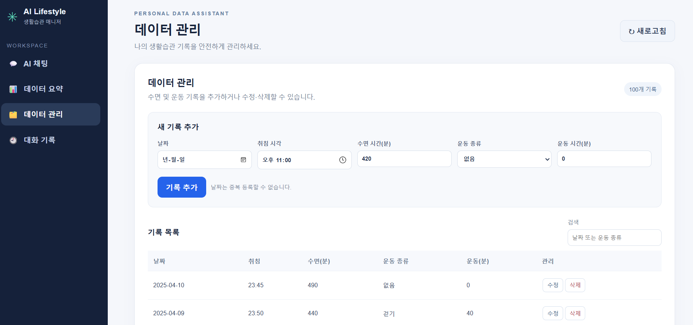

# AI Lifestyle Manager | AI 생활습관 매니저

> Firebase Firestore에 저장된 개인별 수면·운동 기록을 관리하고, 데이터 요약을 바탕으로 생활습관에 대해 대화하는 AI agent입니다.

## 1. 프로젝트 소개

**AI Lifestyle Manager**는 날짜별 수면 및 운동 데이터를 기록·관리하고, 축적된 데이터를 분석하여 개인의 생활습관을 이해하도록 돕는 웹 서비스입니다. 사용자는 브라우저에서 기록을 추가·수정·삭제하고, 요약 통계를 확인하며, AI에게 개선 방향을 질문할 수 있습니다. AI와 주고받은 대화는 Firestore에 저장되어 이후 다시 불러와 이어서 대화할 수 있습니다.

본 프로젝트는 **시계열 데이터 저장**, **CRUD API**, **데이터 요약 API**, **데이터 기반 AI 채팅**, **대화 이력 저장**을 하나의 서비스로 통합하는 것을 목표로 개발했습니다.

## 2. 서비스 및 저장소 링크

| 구분 | URL |
| --- | --- |
| 프론트엔드 (Vercel) | https://aiagentdesign.vercel.app |
| 백엔드 API (Render) | https://ai-lifestyle-manager-api.onrender.com |
| Swagger API 문서 | https://ai-lifestyle-manager-api.onrender.com/docs |
| GitHub 저장소 | https://github.com/U-an74/AI_Agent_design |

> **참고:** Render 무료 인스턴스는 유휴 상태에서 중지될 수 있어 첫 API 요청이 지연될 수 있습니다. 프론트엔드는 데이터 로딩 및 연결 오류 메시지를 표시하며, 첫 접속 시 응답이 지연되면 다시 시도해 주세요.

## 3. 주요 기능

### 3.1 데이터 기반 AI 채팅

- 사용자의 질문에 저장된 생활습관 **요약 통계**를 반영하여 AI 답변 생성
- 새 대화 시작 및 동일 대화 내 후속 질문 지원
- 최근 대화 메시지를 컨텍스트로 전달하여 문맥 유지
- 응답 대기 상태 및 오류 메시지 표시
- 질문과 답변을 Firestore에 자동 저장

### 3.2 생활습관 데이터 관리 (CRUD)

- 날짜별 수면·운동 기록 조회, 추가, 수정, 삭제
- 입력 필드: `date`, `sleep_start_time`, `sleep_minutes`, `exercise_type`, `exercise_minutes`
- 동일 날짜 중복 등록 방지 및 입력값 검증
- 화면에서 날짜/운동 종류 검색

### 3.3 생활습관 요약 분석

- 데이터 기간 및 총 기록 수
- 평균·최대·최소 수면 시간
- 평균·최대·최소 운동 시간 및 운동 종류별 횟수
- 목표 취침 시간대(23:00~03:00) 준수율
- 최근 7개 기록과 이전 7개 기록의 취침 패턴 비교

### 3.4 대화 기록 관리

- AI 대화 기록 목록 조회
- 이전 대화 및 메시지 불러오기
- 기존 대화에서 후속 질문 이어가기
- 필요 없는 대화 기록 삭제

## 4. 기술 스택

| 영역 | 기술 |
| --- | --- |
| Frontend | HTML5, CSS3, Vanilla JavaScript |
| Backend | Python, FastAPI, Uvicorn, Pydantic |
| Database | Firebase Cloud Firestore |
| AI 모델 | Codyssey API (gpt-5.4) |
| AI 연동 | OpenAI Python SDK (Chat Completions API 호환 인터페이스) |
| Frontend 배포 | Vercel (정적 사이트) |
| Backend 배포 | Render (Web Service) |
| 버전 관리 | Git, GitHub |

프론트엔드는 React나 Vue 등의 프레임워크 없이 **순수 HTML/CSS/JavaScript**로 작성했습니다.

## 5. 시스템 구성

```text
사용자 브라우저
    │
    ▼
Vercel ── HTML / CSS / Vanilla JavaScript
    │
    │ HTTPS REST API 요청
    ▼
Render ── FastAPI (Python)
    ├── Firebase Firestore ── 날짜별 생활습관 데이터 및 대화 기록 저장
    └── AI 채팅 API ── 요약 통계와 대화 문맥을 전달해 답변 생성
```

AI 채팅 흐름은 **질문 입력 → FastAPI에서 Firestore 통계 요약 → AI 모델에 요약·대화 문맥 전달 → 답변 생성 → 대화 저장 → 화면 표시** 순서입니다.

## 6. 프로젝트 구조

```text
AI-lifestyle-manager/
├── backend/
│   ├── main.py               # FastAPI 엔드포인트 및 AI 채팅
│   ├── firebase.py           # Firebase Admin SDK 초기화
│   ├── requirements.txt      # Python 의존성
│   ├── .env.example          # 환경 변수 예시
│   └── .python-version       # Render Python 버전
├── frontend/
│   ├── index.html            # 메인 화면
│   ├── style.css             # UI 스타일
│   ├── app.js                # API 통신 및 사용자 기능
│   ├── config.js             # 로컬 API 주소 설정
│   └── build.mjs             # Vercel 빌드 시 환경 변수 주입
├── .gitignore
└── README.md
```

로컬 개발 시에는 별도 `secrets/` 폴더에 Firebase 서비스 계정 키 파일을 두며, **비밀 키와 `.env` 파일은 Git에 포함하지 않습니다.**

## 7. 로컬 실행 방법

### 7.1 저장소 복제 및 백엔드 설치

```bash
git clone https://github.com/U-an74/AI_Agent_design.git
cd AI_Agent_design
python -m venv .venv
```

가상환경 활성화:

Windows PowerShell:

```powershell
.venv\Scripts\Activate.ps1
```

macOS/Linux:

```bash
source .venv/bin/activate
```

의존성 설치 및 서버 실행:

```bash
pip install -r backend/requirements.txt
cd backend
uvicorn main:app --reload --port 8000
```

- 로컬 백엔드: http://127.0.0.1:8000
- 로컬 Swagger: http://127.0.0.1:8000/docs

### 7.2 백엔드 환경 변수

`backend/.env.example`을 참고해 `backend/.env` 파일을 만들고 본인의 인증 정보를 설정합니다.

```dotenv
# 로컬: backend/ 기준 상대경로
FIREBASE_CREDENTIALS=../secrets/firebase-service-account.json

# AI API 설정
OPENAI_API_KEY=YOUR_API_KEY
OPENAI_MODEL=gpt-5.4
# OpenAI 호환 API를 사용할 경우 사용할 엔드포인트 예시
OPENAI_BASE_URL=https://copa.codyssey.kr/v1
```

Firebase 서비스 계정 JSON 파일은 로컬의 `secrets/firebase-service-account.json`에 별도로 보관합니다. Render에서는 파일 경로 대신 **`FIREBASE_SERVICE_ACCOUNT_JSON`** 환경 변수에 서비스 계정 JSON 문자열을 등록할 수 있습니다.

> **AI API 설정:** OpenAI Python SDK는 `OPENAI_BASE_URL` 환경 변수를 지원하므로, 현재 코드처럼 클라이언트 생성 시 `base_url`을 별도로 명시하지 않아도 해당 값을 사용합니다. 로컬과 Render에서 동일한 COPA 엔드포인트를 쓰려면 `OPENAI_BASE_URL`을 설정하세요. API 키는 절대 GitHub나 브라우저 코드에 포함하지 마세요.

### 7.3 프론트엔드 실행

별도 터미널에서 저장소 최상위 폴더로 이동한 후 실행합니다.

```bash
cd frontend
python -m http.server 5500
```

브라우저에서 http://localhost:5500 접속.

- `frontend/config.js` 또는 `app.js`의 API 주소 설정은 사용하려는 백엔드 주소에 맞게 구성합니다.
- 현재 프론트엔드는 배포된 Render API 주소를 기본값으로 사용합니다.
- 로컬 FastAPI에 연결하려면 API 주소를 `http://127.0.0.1:8000`으로 변경하고, 백엔드 CORS 허용 출처 설정을 확인하세요.

## 8. Vercel / Render 배포 설정

### 8.1 Vercel — 프론트엔드

| 항목 | 설정값 |
| --- | --- |
| Repository | `U-an74/AI_Agent_design` |
| Root Directory | `frontend` |
| Application Preset | `Other` |
| Build Command | `node build.mjs` |
| Output Directory | `dist` |
| 환경 변수 | `API_BASE_URL=https://ai-lifestyle-manager-api.onrender.com` |

`build.mjs`는 배포 시 `API_BASE_URL`을 읽어 `dist/config.js`를 생성합니다. 정적 웹페이지의 JavaScript는 Vercel 환경 변수를 직접 읽을 수 없으므로, **빌드 시점에 공개 API URL만 브라우저용 설정 파일로 전달**합니다.

### 8.2 Render — 백엔드

- 서비스 유형: Python Web Service
- Root Directory: `backend`
- 설치 명령 예시: `pip install -r requirements.txt`
- 실행 명령 예시: `uvicorn main:app --host 0.0.0.0 --port $PORT`
- 환경 변수: `FIREBASE_SERVICE_ACCOUNT_JSON`, `OPENAI_BASE_URL`, `OPENAI_API_KEY`, `OPENAI_MODEL`
- CORS 허용 출처: `https://aiagentdesign.vercel.app`, `http://localhost:5500`, `http://127.0.0.1:5500`

**주의:** Firebase 인증 JSON과 AI API 키 등 비밀 정보는 Render 환경 변수에서만 관리하고, 프론트엔드 또는 GitHub에 공개하지 않습니다.

## 9. API 목록

| Method | Endpoint | 설명 |
| --- | --- | --- |
| GET | `/` | 서버 상태 확인 |
| POST | `/api/data` | 생활습관 기록 추가 |
| GET | `/api/data` | 생활습관 기록 전체 조회 |
| PUT | `/api/data/{data_id}` | 생활습관 기록 수정 |
| DELETE | `/api/data/{data_id}` | 생활습관 기록 삭제 |
| GET | `/api/data/summary` | 데이터 요약 통계 |
| POST | `/api/conversations` | 대화 기록 생성 |
| GET | `/api/conversations` | 대화 목록 조회 |
| GET | `/api/conversations/{conversation_id}` | 개별 대화 및 메시지 조회 |
| DELETE | `/api/conversations/{conversation_id}` | 대화 기록 삭제 |
| POST | `/api/chat` | 데이터 기반 AI 채팅 |

총 **11개 API 동작**을 FastAPI Swagger에서 확인할 수 있습니다.

## 10. 데이터 구성 및 검증 결과

### 10.1 샘플 데이터

테스트용 생활습관 기록 **100개**(2025-01-01 ~ 2025-04-10)를 Firestore에 저장했습니다.

| 지표 | 검증 당시 값 |
| --- | --- |
| 전체 기록 수 | 100개 |
| 평균 수면 시간 | 430.9분 (약 7시간 11분) |
| 평균 운동 시간 | 22.7분 |
| 운동하지 않은 날 | 37일 (37%) |
| 목표 취침 시간대 준수율 | 88% |
| 최근 7개 vs 이전 7개 취침 패턴 | 100% vs 100%, 유지 |

위 수치는 테스트용 샘플 데이터 기준이며 실제 기록 추가·수정·삭제에 따라 변할 수 있습니다.

### 10.2 기능 테스트

| 구분 | 테스트 결과 |
| --- | --- |
| STEP 11 — Swagger 및 예외 처리 | CRUD, 요약 API, 대화 이력, AI 채팅, 입력 검증 확인 |
| STEP 12 — Render 배포 | 배포 후 API, Firestore 연결, AI 채팅 동작 확인 |
| STEP 13 — 로컬 프론트엔드 | AI 첫 질문·후속 질문, CRUD, 이전 대화 불러오기 **6/6 통과** |
| STEP 14 — Vercel 배포 | 실제 배포 주소에서 AI 채팅, CRUD, 이전 대화 불러오기, 기록 수 복원 **7/7 통과** |

테스트를 위해 추가한 임시 데이터는 삭제했으며, 검증 종료 시 샘플 기록 수 **100개**를 확인했습니다.

## 11. 시연 화면

최종 제출 시 실제 서비스에서 촬영한 스크린샷을 `docs/screenshots/`에 추가한 다음 아래 링크를 활성화합니다.

<!-- 캡처 파일 추가 후 주석을 제거하세요.
### AI 채팅 및 데이터 기반 답변


### 데이터 추가·수정·삭제


### 이전 대화 불러오기

-->

필요한 캡처: **① AI 질문 및 데이터 기반 답변, ② 데이터 CRUD, ③ 이전 대화 기록 불러오기**.

## 12. 현재 한계점 및 향후 고도화 과제

### 12.1 현재 한계점 — 요약 통계 중심의 AI 분석

현재 서비스는 날짜별 수면 시간과 운동 종류·시간이 연결된 **원본 데이터**를 Firestore에 저장합니다. 그러나 AI 채팅에서는 원본 기록 전체를 질문별로 탐색하는 대신, 백엔드가 미리 계산한 **전체 요약 통계**를 주로 전달합니다.

따라서 **“운동한 날과 운동하지 않은 날의 평균 수면 시간은 얼마나 차이가 나는가?”**와 같이 날짜별 기록을 묶어 새로 계산해야 하는 질문에는 정확한 수치를 바로 제시하기 어렵습니다. 원본 데이터가 없는 것이 아니라, **질문에 맞춰 원본 데이터를 조회·집계하는 기능이 아직 구현되지 않은 것**이 한계입니다.

### 12.2 향후 고도화 — 질문 기반 동적 데이터 분석

향후 다음 흐름으로 기능을 확장할 계획입니다.

1. **질문 의도 분석:** 자연어 질문에서 기간, 비교 대상, 통계 항목 등을 추출
2. **동적 데이터 조회:** 필요한 날짜별 Firestore 원본 기록을 선택적으로 조회
3. **통계 자동 계산:** 운동 유무별 평균 수면, 운동 종류별 비교, 기간별 변화량 등을 백엔드에서 정확하게 계산
4. **근거 기반 AI 답변:** 계산된 통계와 분석 조건을 GPT에 전달해 수치와 해석을 함께 제공

이 기능은 **현재 구현 완료된 기능이 아닌 향후 고도화 계획**입니다. 이를 통해 미리 정의된 요약 지표를 설명하는 수준을 넘어 다양한 개인 맞춤 분석 질문에 대응할 수 있도록 발전시키려 합니다.

### 12.3 추가 개선 방향

- 사용자별 로그인·인증 및 데이터 접근 권한 분리
- 데이터 시각화 및 기간별 추세 비교 확대
- 개인별 목표 설정과 주기적인 생활습관 피드백
- 운영 환경에서의 데이터 보호 및 보안 정책 강화

> **보안 및 사용 범위:** 현재 프로젝트는 학습·시연 목적의 프로토타입이며, 사용자별 인증/권한 분리가 구현된 서비스로 간주해서는 안 됩니다. 공개 배포 환경에서는 실제 민감한 건강정보가 아닌 **테스트용 또는 합성 데이터**만 사용하세요. AI 답변은 의료적 진단이나 치료 조언을 대체하지 않습니다.

---

**개발 목적:** 데이터 기반 개인 AI 서비스 구축 실습 · **배포 및 프론트엔드 통합 테스트 완료**
